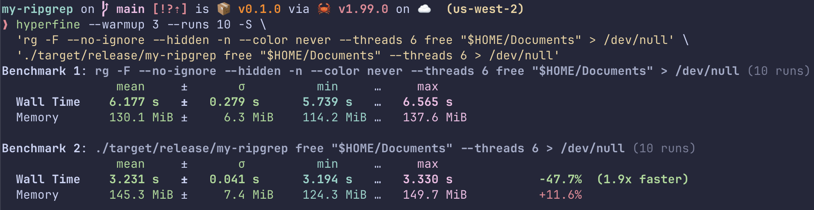

# my-ripgrep

**A concurrent, literal-text search tool built from scratch in Rust.**

`my-ripgrep` is a command-line file searcher inspired by [ripgrep](https://github.com/BurntSushi/ripgrep). It recursively searches directories, distributes file-processing work across a custom thread pool, and reports matching lines with file paths and line numbers.

The project is a hands-on exploration of **systems programming, concurrency, buffered I/O, allocation costs, and performance measurement**. Its core search and scheduling implementation uses Rust's standard library rather than a third-party search engine or thread-pool crate.

> **Scope:** This is an educational systems-programming project, not a drop-in replacement for ripgrep. The performance results below describe one measured workload, not a universal speed advantage.

## At a glance

- Recursive directory traversal and single-file search
- Configurable parallelism using a custom `std::thread` worker pool
- Literal substring matching, with optional ASCII-oriented case-insensitive search
- File-extension filtering and directory-name exclusions
- Buffered, line-by-line file processing with reader reuse within work batches
- Per-search statistics: files processed, lines scanned, matches, and elapsed time
- **1.91× faster than ripgrep on one verified, six-thread benchmark** (with higher memory usage)

## Getting started

### Requirements

- Rust and Cargo
- A Unix-like environment for the current implementation (the reusable reader is initialized using `/dev/null`)

Build the release executable from the repository root:

```bash
cargo build --release
```

Run it:

```bash
./target/release/my-ripgrep "TODO" ./src
```

Or use Cargo:

```bash
cargo run --release -- "TODO" ./src
```

### CLI options

```text
my-ripgrep <pattern> <file-or-directory> [options]
```

| Option | Description |
| --- | --- |
| `--threads <N>` | Number of worker threads for directory searches (default: `1`; must be greater than zero). |
| `--ignore-case` | ASCII-oriented case-insensitive matching. |
| `--extension <EXT>` | Include files with the specified extension; may be repeated. |
| `--exclude <NAME>` | Skip directories with the specified name; may be repeated. |

**Examples**

```bash
# Search a directory recursively
./target/release/my-ripgrep "TODO" ./src

# Search with six worker threads
./target/release/my-ripgrep "free" "$HOME/Documents" --threads 6

# Search selected source extensions and skip generated directories
./target/release/my-ripgrep "video" ./projects \
  --ignore-case \
  --extension ts \
  --extension tsx \
  --exclude node_modules \
  --exclude target

# Search one file
./target/release/my-ripgrep "ERROR" ./logs/app.log
```

Matches are printed in `path:line:content` format, followed by a summary such as:

```text
Amount files: 128 -- Amount lines: 20480 -- Amount matches: 37 -- Time: 12345 microseconds.
```

Results from parallel directory searches are **not guaranteed to be in a stable order**.

## Architecture

The implementation separates file discovery, task scheduling, file searching, and result collection.

```text
                    Input path + search options
                               |
                       Recursive traversal
                               |
                  Extension / directory filters
                               |
                    Collect eligible files
                               |
                       Batch 16 files
                               |
                   Bounded task channel
                     sync_channel(64)
                               |
                  +------------+------------+
                  |            |            |
               Worker 1     Worker 2     Worker N
                  |            |            |
             BufReader    BufReader    BufReader
             reused per   reused per   reused per
                batch        batch        batch
                  |            |            |
                  +------------+------------+
                               |
                       Result channel
                               |
                       Collector thread
                               |
                 Matches + aggregate statistics
                               |
                           CLI output
```

### Execution flow

1. **Discover files.** Traverse the directory tree and apply exclusion and extension filters. A single-file input takes a direct search path.
2. **Create work units.** Group eligible files into batches of **16**, reducing the number of tasks submitted to the pool.
3. **Schedule tasks.** Submit batches through a **bounded channel of capacity 64**. Workers receive tasks through a shared `Receiver` protected by `Arc<Mutex<_>>`.
4. **Search files.** Each worker processes its assigned batch, reading one line at a time. A `BufReader<File>` is reused across files in that batch.
5. **Collect results.** Workers send completed batches through a separate result channel. A collector thread accumulates them until execution finishes.
6. **Report.** Aggregate match counts, scanned lines, processed files, and elapsed time; then print the matches and summary.

**Concurrency detail:** The mutex protects access to the task receiver **while a worker receives a task**. It does not surround the file-search operation; workers can read and search different files concurrently.

## Design decisions

### Why implement a thread pool?

The goal was to learn thread coordination, ownership transfer, message passing, shutdown, and joining worker threads using Rust's standard library. A library-provided pool would have hidden much of the behavior this project is intended to explore.

### Why batch 16 files per task?

Scheduling each small file as a separate task can introduce avoidable channel and dispatch overhead. Batching amortizes that cost. The batch size is an implementation choice, not a claim that 16 is optimal for every workload.

### Why use a bounded task queue?

`sync_channel(64)` limits the number of **pending tasks** in the channel and provides backpressure to the producer. It does **not** bound total memory usage: the current design collects file entries before scheduling and retains results until completion.

### Why reuse `BufReader`?

Profiling with macOS Instruments highlighted repeated buffered-reader allocations. Reusing the reader's allocation within a batch was an experiment to reduce allocation churn. Before swapping the underlying file, the implementation consumes any buffered bytes left from the previous file.

### Why literal matching?

Literal substring matching keeps the search core small enough to study I/O, concurrency, and allocation behavior without introducing a regex engine. The trade-off is a much narrower feature set than ripgrep.

## Performance

### Verified large-directory benchmark — October 12, 2026

A search for the literal string `free` across a real-world `~/Documents` directory containing source code, dependencies, and generated artifacts.

**Test environment**

| Parameter | Value |
| --- | --- |
| CPU | Apple M2 Pro |
| RAM | 16 GiB |
| OS | macOS 27.0.1 |
| Rust | `rustc 1.99.0` (release build) |
| ripgrep | `15.2.0` |
| Dataset | `~/Documents`, approximately 23.86 GiB of disk usage in an earlier inventory |
| Worker threads | 6 for both tools |
| Benchmark | Hyperfine, 3 warmups, 10 measured runs |
| Output | Redirected to `/dev/null` |

**Measured results**

| Metric | ripgrep | my-ripgrep | Difference |
| --- | ---: | ---: | ---: |
| Mean wall time | 6.177 s | **3.231 s** | **−47.7%** |
| Standard deviation | 0.279 s | **0.041 s** | — |
| Minimum wall time | 5.739 s | **3.194 s** | — |
| Maximum wall time | 6.565 s | **3.330 s** | — |
| Reported memory | **130.1 MiB** | 145.3 MiB | **+11.6%** |

On this workload, **my-ripgrep completed the search approximately 1.91× as fast as ripgrep**, while using approximately **15.2 MiB more memory**. The memory figures are those reported by the benchmark tool.



**Reproduce the timing experiment**

```bash
cargo build --release

hyperfine --warmup 3 --runs 10 -S \
  'rg -F --no-ignore --hidden -n --color never --threads 6 free "$HOME/Documents" > /dev/null' \
  './target/release/my-ripgrep free "$HOME/Documents" --threads 6 > /dev/null'
```

### Correctness check for the benchmark query

Timing alone is not enough: a faster search is not useful if it silently misses matches or changes their contents. For the `free` query above, the outputs were captured, sorted, and compared with `diff`. The comparison reported **no differences** after removing my-ripgrep's two-line summary suffix.

```bash
DIR="$HOME/Documents"

rg -F --no-ignore --hidden -n --color never \
  'free' "$DIR" > /tmp/rg-results.txt

./target/release/my-ripgrep \
  'free' "$DIR" --threads 6 > /tmp/my-results.txt

# Remove the trailing blank line and statistics line.
# This is compatible with the BSD utilities included in macOS.
sed '$d' /tmp/my-results.txt | sed '$d' | \
  LC_ALL=C sort > /tmp/my-clean.txt

LC_ALL=C sort /tmp/rg-results.txt > /tmp/rg-clean.txt

diff -q /tmp/rg-clean.txt /tmp/my-clean.txt
```

A successful comparison prints nothing. This check detected and helped fix output-formatting differences, including preservation of **CRLF (`\r\n`)** line endings.

> **Interpretation:** The sorted outputs matched byte-for-byte for **this query and this directory snapshot**. This does not prove identical behavior for arbitrary patterns, encodings, binary files, or directory trees. Both tools were configured with six threads, but their internal work and feature handling can still differ. Benchmark outcomes are workload- and machine-dependent.

### Optimization process

The performance work followed a measurement-driven loop:

1. Establish a baseline against ripgrep.
2. Profile allocation behavior with macOS Instruments.
3. Experiment with buffered-reader reuse, file batching, and task scheduling.
4. Rebuild in release mode and measure with Hyperfine.
5. Compare search outputs to catch correctness regressions.

The benchmark demonstrates the result of the current design on one workload; it does not isolate the contribution of each optimization.

## Testing

Run the Rust test suite:

```bash
cargo test
```

The source includes unit tests for argument parsing and validation, extension filtering, line numbers and case sensitivity, directory traversal and exclusions, missing files, single-file searches, summary formatting, and thread-pool task collection. The benchmark comparison above provides an additional **manual integration check** against ripgrep for one large dataset.

**Further tests worth adding:** cross-thread-count equivalence, more line-ending cases, binary/non-UTF-8 inputs, and repeatable fixtures for output comparisons.

## Limitations and trade-offs

- **Literal search only.** No regular expressions, glob language, or ripgrep-compatible option set.
- **Different ignore behavior.** The tool does not implement ripgrep's `.gitignore` rules or its full file-selection semantics.
- **UTF-8 line reading.** `BufRead::read_line` requires valid UTF-8; files with invalid UTF-8 may be skipped or only partially processed.
- **ASCII-oriented case-insensitive matching.** This is not full Unicode case folding.
- **Memory retention.** Eligible files are collected before dispatch, and matches are accumulated before output. The bounded task queue does not remove these costs.
- **Nondeterministic result order.** Parallel task completion determines collection order; sort externally when comparing results.
- **Platform assumptions.** The current reader initialization uses `/dev/null`, so Windows support is not established. Cross-platform CI has not been verified.
- **Error handling.** Some unreadable files are skipped, while certain directory traversal failures may terminate execution; error behavior is not equivalent to ripgrep's.

Potential next steps include streaming discovery/results, more robust encoding and binary handling, deterministic output modes, broader regression fixtures, and cross-platform testing.

## Motivation

`my-ripgrep` is a practical exercise in building a useful tool while understanding **how Rust's ownership model interacts with threads, channels, file I/O, and memory management**. The most valuable outcome is not outperforming a mature tool on a single benchmark; it is being able to explain the architecture, measure trade-offs, find correctness bugs, and improve the implementation based on evidence.
